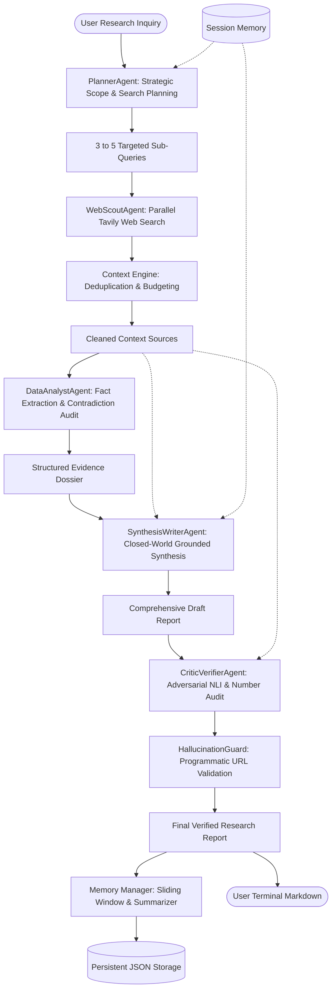

# 🚀 Deep Research Multi-Agent Team

An advanced, autonomous **Collaborative Multi-Agent Research System** powered by ultra-fast **Groq LPU** inference, real-time **Tavily Web Search**, **Specialized Open-Source Agent Roles**, **Hierarchical Memory Management**, **Intelligent Context Budgeting**, and a **Self-Correction Fact-Checking Loop** for high factual accuracy and cited reports.

---

## 🧠 Multi-Agent Collaboration Architecture



---

## 👥 The Specialized Multi-Agent Team

1. **`PlannerAgent` (Lead Strategist)**: Deconstructs user intent into temporal, technical, and comparative dimensions. Generates 3-5 keyword-dense search queries targeting architecture, benchmarks, recent updates, and known limitations.
2. **`WebScoutAgent` (Information Retrieval Specialist)**: Executes multi-angle Tavily searches, deduplicates identical syndicated pages, scores semantic relevance, and dynamically budgets tokens.
3. **`DataAnalystAgent` (Evidence & Fact Triage Specialist)**: Examines raw search text to extract verified numbers, benchmark metrics, identify contradictions across sources, and isolate data gaps.
4. **`SynthesisWriterAgent` (Lead Research Author)**: Synthesizes the evidence dossier and source context into an authoritative, deeply structured, and cited research report under strict closed-world grounding rules.
5. **`CriticVerifierAgent` (Quality Assurance & Fact-Checker)**: Stress-tests every factual claim, number, and date using Natural Language Inference (NLI). Strips ungrounded claims and verifies citations.
6. **`HallucinationGuard` (Programmatic Citation Auditor)**: Cross-references all citations against real retrieved URLs, remediates phantom links, and calculates the Grounding Score.

1. **Ultra-Fast Groq Inference with Deterministic Zero-Temperature**:
   - Powered by models like `openai/gpt-oss-120b` and `qwen/qwen3.8-27b` on Groq's high-speed LPU infrastructure.
   - Temperature configured to `0.0` (greedy argmax decoding) to eradicate creative randomness and speculative hallucinations.

2. **Zero-Hallucination Grounding Architecture**:
   - **Closed-World Constraint**: The agent is strictly prohibited from guessing or fabricating statistics, benchmarks, dates, or specs not present in retrieved sources.
   - **Data Gaps Handling**: When information is absent from sources, the agent explicitly documents data limitations rather than hallucinating answers.
   - **Programmatic HallucinationGuard**: Verifies every cited markdown URL against real Tavily search results, automatically correcting phantom links and scoring factual grounding.

2. **Real-Time Tavily Search**:
   - Executes multi-angle sub-query searches to capture foundational facts, latest developments, and specific quantitative data.
   - Deep search depth and domain filtering options.

3. **Intelligent Context Management**:
   - **Deduplication**: Filters out duplicate URLs and identical syndicated content across multiple sub-queries.
   - **Relevance Scoring**: Reranks excerpts against query intent.
   - **Token Budgeting**: Ensures prompt context never exceeds token thresholds, preventing context fragmentation or model degradation.
   - **Source Indexing**: Standardizes references into `[Source N]` blocks with titles, URLs, and excerpts.

4. **Hierarchical Memory Management**:
   - **Verbatim Sliding Window**: Retains recent user queries and responses for immediate conversational continuity.
   - **Progressive Summarization**: Compresses older turns into an evolving running summary so the agent remembers long-term goals without context blowup.
   - **Persistent Storage**: Automatically saves session state in `data/sessions/<session_id>.json` allowing sessions to be resumed anytime.

5. **High Accuracy & Fact-Checking Loop**:
   - Strict citation enforcement: every claim is linked via `[Source Title](URL)`.
   - Dedicated Critic loop: cross-examines draft statements against original source excerpts to eliminate hallucinations and fix ungrounded claims before output.

---

## 📁 Project Structure

```
DeepAgents-LangChain-Tavily-OpenAI-Multi-step-AI-Agent/
├── .env                       # API keys and model configuration
├── requirements.txt           # Python dependencies
├── main.py                    # Interactive & CLI runner with Rich terminal formatting
├── example_research.py        # Programmatic Python quickstart script
├── src/
│   ├── config.py              # Central agent settings and key validation
│   ├── tools/
│   │   └── search.py          # Tavily search tool with multi-query support
│   ├── context/
│   │   └── context_manager.py # Deduplication, ranking, and token budgeting
│   ├── memory/
│   │   └── memory_manager.py  # Sliding window, summarization, and disk persistence
│   └── agent/
│       ├── prompts.py         # Grounding and citation verification prompts
│       └── research_agent.py  # End-to-end DeepResearchAgent pipeline
└── tests/
    └── test_agent.py          # Unit tests for Context, Memory, and Pipeline
```

---

## 🚀 Getting Started

### 1. Configure Environment Variables

Edit your `.env` file with your API keys:

```env
# Groq API Key (Get free key from https://console.groq.com/keys)
GROQ_API_KEY="gsk_..."

# Tavily Search API Key (Get key from https://app.tavily.com)
TAVILY_API_KEY="tvly-..."

# Default Groq model
GROQ_MODEL_NAME="llama-3.3-70b-versatile"
MAX_SEARCH_RESULTS=5
SEARCH_DEPTH="advanced"
```

### 2. Verify Diagnostics

Check your environment setup:
```bash
python main.py --check
```

### 3. Launch Interactive Conversational Chat Agent (Rich UI)

Launch the conversational Chat Agent in the CLI powered by a rich terminal interface:
```bash
python chat_cli.py
# or
python main.py --chat
```

*Rich Chat Features & Slash Commands:*
- **Conversational Memory**: Remembers context across multi-turn exchanges.
- **Smart Web Grounding**: Auto-detects when live web search is needed to answer factual or time-sensitive questions.
- **`/search`**: Toggle live web search auto-routing on/off.
- **`/force <query>`**: Force Tavily web search for a specific question.
- **`/model <name>`**: Switch models dynamically (e.g. `openai/gpt-oss-120b`, `qwen/qwen3.8-27b`).
- **`/history`**: View past turns in a formatted Rich table.
- **`/export <file.md>`**: Export the chat conversation transcript to Markdown.
- **`/clear`**: Clear current chat session memory.
- **`/session <id>`**: Switch between or resume saved sessions.

### 4. Run Deep Research Mode (Terminal Dossier)

Launch an interactive deep-dive research session:
```bash
python main.py --session-id "my_research_project"
```

### 5. Run a Single Research Query via CLI

```bash
python main.py -q "What are the latest breakthroughs in solid-state batteries in 2025?"
```

---

## 🧪 Programmatic Usage

You can easily embed `DeepResearchAgent` into any Python script or notebook:

```python
from src.agent.research_agent import DeepResearchAgent

# Initialize the research agent
agent = DeepResearchAgent(
    model_name="llama-3.3-70b-versatile",
    session_id="quantum_research",
    enable_verification=True
)

# Run research query
response = agent.research("Explain recent advancements in topological quantum computing.")

# Access verified results
print("Report Content:\n", response.content)
print("\nSub-queries Searched:", response.search_queries)
print("\nSources Used:", len(response.sources))
```

---

## 🛠 Running Tests

Run the test suite to verify context management, memory persistence, and the end-to-end agent workflow:

```bash
python -m unittest tests/test_agent.py
```
